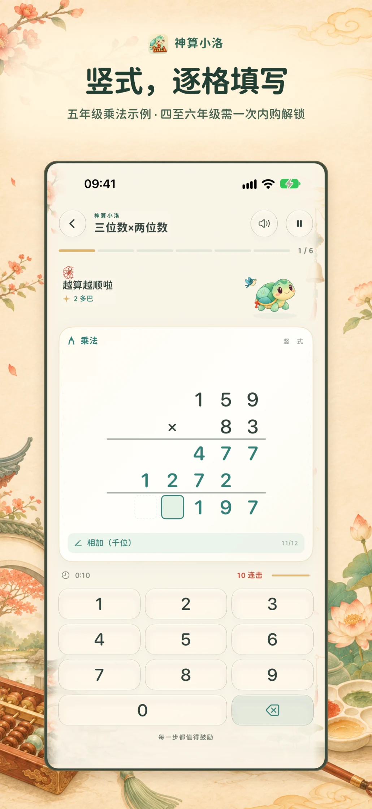
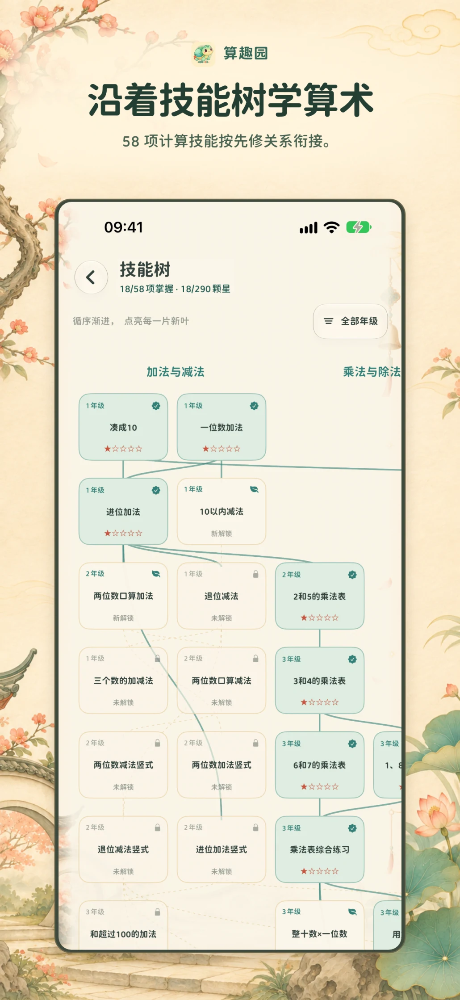
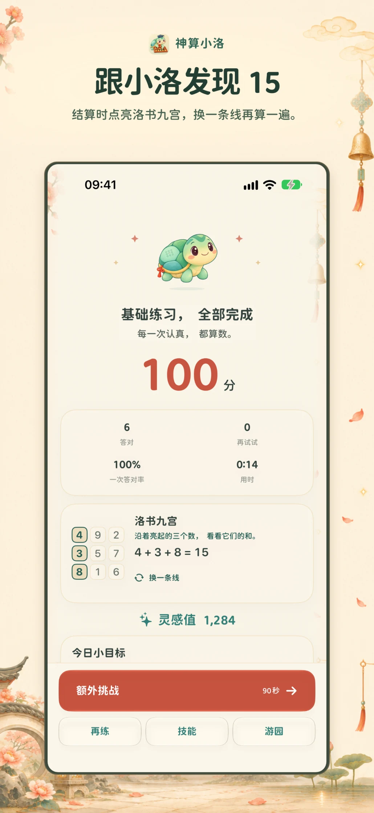
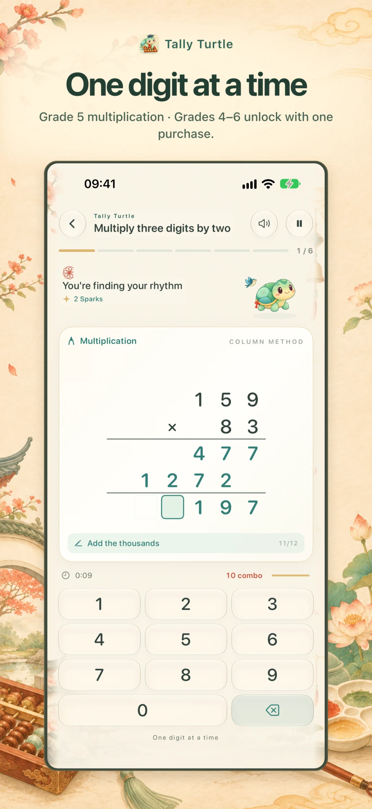
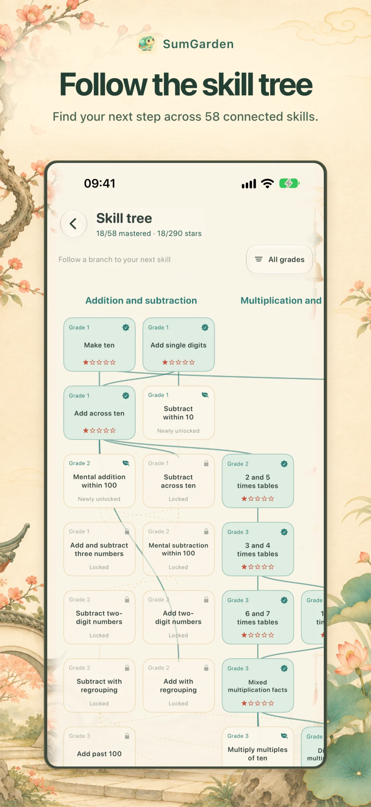
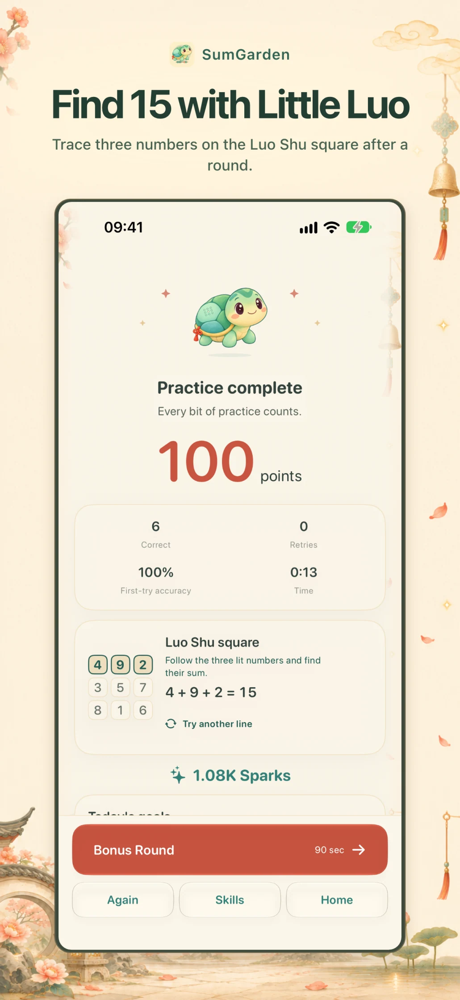

# 算趣园 · SumGarden

[简体中文](https://gptalgopro.github.io/SumGarden-Guide/zh/) · [English](https://gptalgopro.github.io/SumGarden-Guide/en/)

算趣园是一款 iPhone 和 iPad 原生算术教育应用。洛书灵龟小洛陪伴练习，58 项计算技能按先修关系组织。完成一轮后可以探索洛书九宫，观察行、列或对角线上的三个数怎样加成 15。一至三年级免费，四至六年级合计一次性 US$2.99 解锁。各地区价格由 App Store 显示。iPhone Duo 折叠时可从右侧栏操作，展开后可继续填写同一道题。

SumGarden is a native arithmetic education app for iPhone and iPad. Practice 58 connected skills with Little Luo, a young turtle inspired by the traditional Lo Shu story. After a round, explore how each row, column and diagonal of the Lo Shu square adds to 15. Grades 1–3 are free. One US$2.99 purchase unlocks grades 4–6, with local pricing shown by the App Store. On iPhone Duo, the sidebar keeps practice controls within reach and your work carries across folded and unfolded layouts.

[隐私政策](https://gptalgopro.github.io/SumGarden-Guide/zh/privacy/) · [Privacy](https://gptalgopro.github.io/SumGarden-Guide/en/privacy/) · [使用帮助](https://gptalgopro.github.io/SumGarden-Guide/zh/support/) · [Support](https://gptalgopro.github.io/SumGarden-Guide/en/support/) · [Credits](https://gptalgopro.github.io/SumGarden-Guide/en/credits/)

[逐格运算、技能树与洛书九宫](https://gptalgopro.github.io/SumGarden-Guide/zh/#practice) · [Worksheets, skills and the Lo Shu square](https://gptalgopro.github.io/SumGarden-Guide/en/#practice)

  
  
  

  
  
  

[联系开发者 · Contact support](https://github.com/GPTAlgoPro/SumGarden-Guide/issues/new) · [支持邮箱 · Email support](mailto:sunkai4u@gmail.com)
