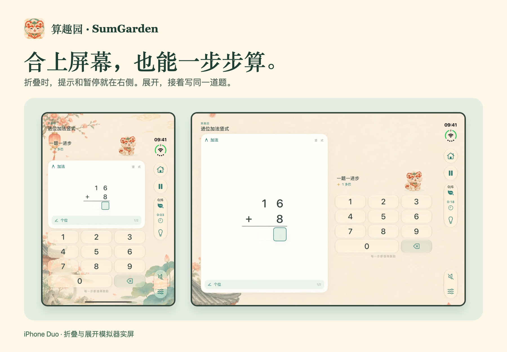
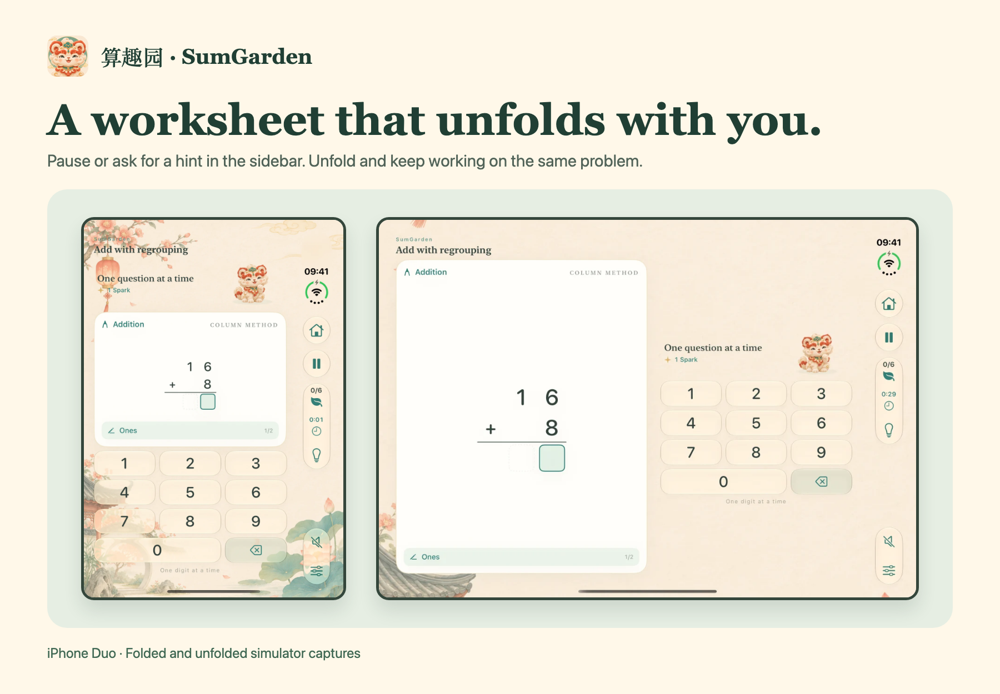

# 算趣园 · SumGarden

[简体中文](https://gptalgopro.github.io/SumGarden-Guide/zh/) · [English](https://gptalgopro.github.io/SumGarden-Guide/en/)

算趣园是一款 iPhone 和 iPad 原生算术教育应用。58 项计算技能按先修关系组织。一至三年级免费，四至六年级合计一次性 US$2.99 解锁。各地区价格由 App Store 显示。iPhone Duo 折叠时可从右侧栏操作，展开后可继续填写同一道题。

SumGarden is a native arithmetic education app for iPhone and iPad. Practice 58 skills in a progression guided by prerequisites. Grades 1–3 are free. One US$2.99 purchase unlocks grades 4–6, with local pricing shown by the App Store. On iPhone Duo, the sidebar keeps practice controls within reach and your work carries across folded and unfolded layouts.

[隐私政策](https://gptalgopro.github.io/SumGarden-Guide/zh/privacy/) · [Privacy](https://gptalgopro.github.io/SumGarden-Guide/en/privacy/) · [使用帮助](https://gptalgopro.github.io/SumGarden-Guide/zh/support/) · [Support](https://gptalgopro.github.io/SumGarden-Guide/en/support/) · [Credits](https://gptalgopro.github.io/SumGarden-Guide/en/credits/)

[联系开发者 · Contact support](https://github.com/GPTAlgoPro/SumGarden-Guide/issues/new) · [支持邮箱 · Email support](mailto:sunkai4u@gmail.com)
